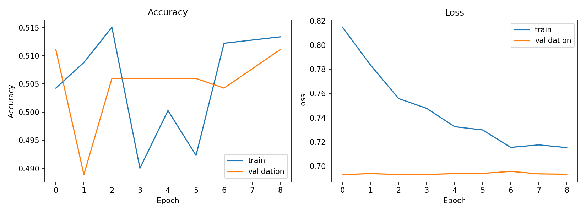
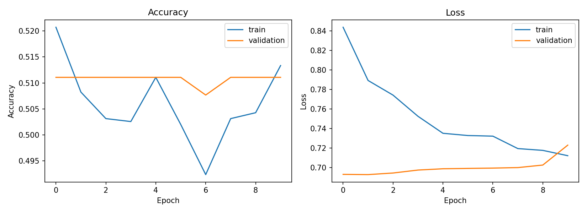
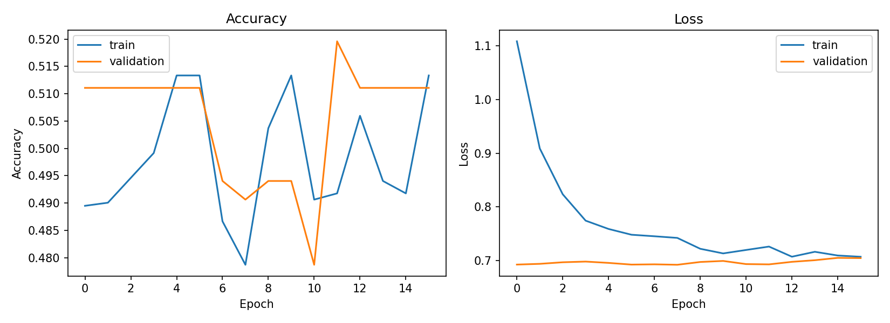
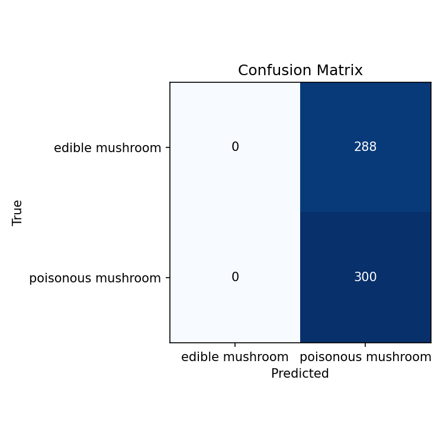
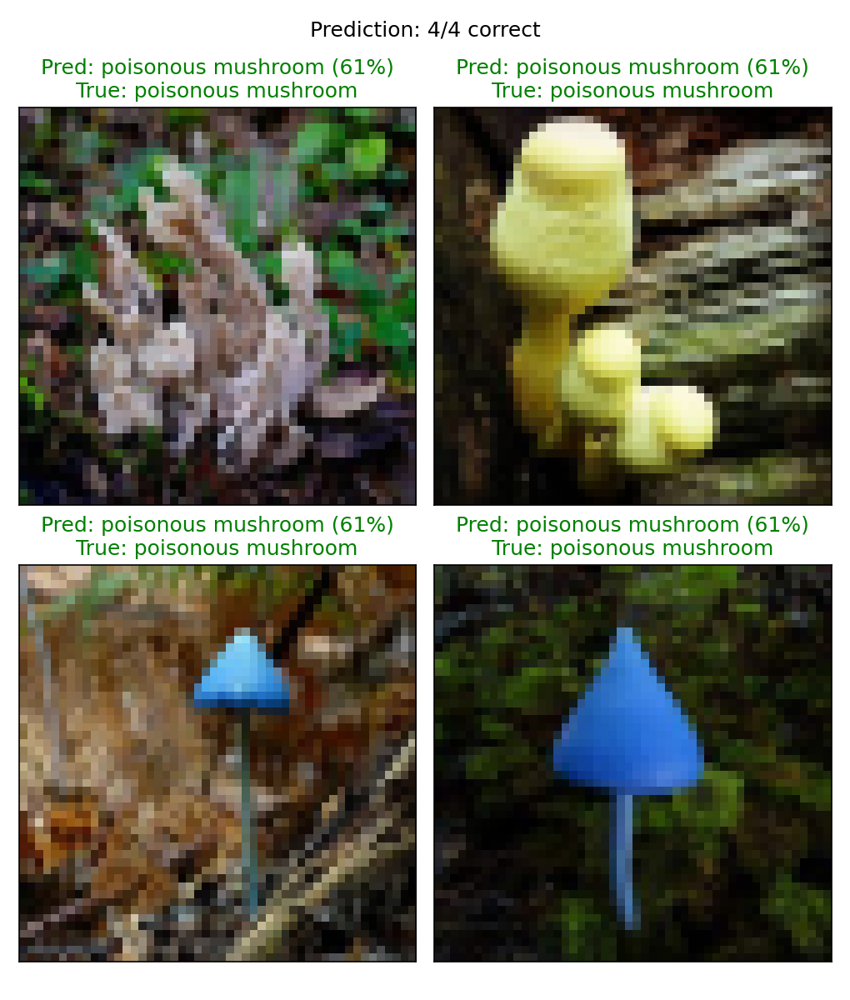

# Machine Learning Project: Edible and Poisonous Mushroom Image Classification (Deep Convolutional Neural Network - DCNN)

## ภาพรวมโปรเจกต์ (Project Overview)
โปรเจกต์นี้เป็นการประยุกต์ใช้เทคนิค Deep Learning โดยใช้โครงข่ายประสาทเทียมแบบคอนโวลูชันเชิงลึก (Deep Convolutional Neural Network - DCNN) ในการจำแนกประเภทของรูปภาพเห็ดว่า "มีพิษ" (Poisonous) หรือ "รับประทานได้" (Edible) โดยเน้นไปที่การศึกษาและเปรียบเทียบสถาปัตยกรรมโครงข่ายที่มีความซับซ้อนต่างกัน ได้แก่ โมเดลขนาดเล็ก (`VGG_SMALL`) และโมเดลมาตรฐาน (`VGG16`) นอกจากนี้ โปรเจกต์ยังมุ่งเน้นการแก้ปัญหาข้อมูลภาพที่ไม่สมดุล (Data Imbalance) ด้วยเทคนิคการจำกัดสัดส่วนภาพ (Data Balancing) และการตั้งค่าสภาพแวดล้อม (Environment) เพื่อดึงพลังการประมวลผลแบบ JIT Compilation จากการ์ดจอมาใช้ลดระยะเวลาในการฝึกสอนโมเดล

## วัตถุประสงค์ (Objectives)
- จัดเตรียมชุดข้อมูลภาพถ่าย (Image Preprocessing) และปรับสมดุลชุดข้อมูล (Data Balancing) ด้วยตัวแปร `MAX_PER_CLASS` เพื่อป้องกันการเอนเอียง (Bias) ของโมเดล
- สร้างและเปรียบเทียบประสิทธิภาพระหว่างสถาปัตยกรรมโครงข่าย `VGG_SMALL` (เลเยอร์น้อย) และ `VGG16` (13 Conv Layers + 3 Dense Layers)
- ทดลองและวิเคราะห์ผลกระทบของการเปลี่ยนจำนวนรอบการฝึกสอน (Epochs) ที่มีต่อการลู่เข้าของโมเดล (Convergence)
- ประเมินประสิทธิภาพของโมเดลผ่านค่าความแม่นยำ (Accuracy), ค่าความสูญเสีย (Loss) และวิเคราะห์พฤติกรรมการจำแนกผ่าน Confusion Matrix
- ตั้งค่า Environment เพื่อใช้งาน TensorFlow ร่วมกับ CUDA Toolkit และ cuDNN สำหรับรันคำสั่งบน GPU บนระบบปฏิบัติการ Windows

## ชุดข้อมูล (Dataset)
- **ชื่อชุดข้อมูล:** Mushroom Dataset Image
- **คำอธิบาย:** ชุดข้อมูลรูปภาพ (Image Data) ของเห็ดที่ถูกจัดเตรียมใหม่ให้อยู่ในรูปแบบ Binary Classification แบ่งเป็น 2 คลาส ได้แก่ `edible mushroom/` (เห็ดที่รับประทานได้ จำนวน 1,436 รูป) และ `poisonous mushroom/` (เห็ดมีพิษ จำนวน 1,808 รูป)
- **ที่มา (Source):** Kaggle https://www.kaggle.com/datasets/quanghn2001/mushroom-dataset-image

## โครงสร้างโปรเจกต์ (Project Structure)
```text
LAB08/
├── image-mushroom-dataset/
│   ├── edible mushroom/
│   └── poisonous mushroom/
└── classification/
    ├── __pycache__/
    ├── outputs/
    │   ├── X_test.npy
    │   ├── X_train.npy
    │   ├── classes.json
    │   ├── confusion_matrix_exp1.png
    │   ├── confusion_matrix_exp2.png
    │   ├── confusion_matrix_exp3.png
    │   └── features.npy
    │   ├── history.json
    │   ├── labels.npy
    │   ├── prediction_sample.png
    │   ├── training_history_exp1.png
    │   ├── training_history_exp2.png
    │   ├── training_history_exp3.png
    │   └── y_test.npy
    │   ├── y_train.npy
    │   └── y_val.npy
    ├── data_loader.py
    ├── evaluate.py
    ├── main.py
    ├── preprocessing.py
    ├── split_data.py
    ├── test_vgg.py
    ├── vgg_model.py
    └── README.md
    └── link-data.txt
    └── requirements.txt
```

## ขั้นตอนการทำงาน (Project Workflow)
1. **Data Loading & Preprocessing (`data_loader.py`, `preprocessing.py`, `split_data.py`):** โหลดภาพจากโฟลเดอร์ ทำการปรับขนาดภาพ และแก้ปัญหาข้อมูลไม่สมดุลด้วยการจำกัดจำนวนภาพ (Balanced Subset) ก่อนแบ่งชุดข้อมูลออกเป็น Train, Validation และ Test
2. **Model Definition (`vgg_model.py`):** กำหนดโครงสร้างของ DCNN โดยสามารถเลือกสลับระหว่าง `VGG_SMALL` และสถาปัตยกรรมระดับลึกอย่าง `VGG16` เพื่อทดสอบประสิทธิภาพการดึงคุณลักษณะเฉพาะ (Feature Extraction)
3. **Model Training (`main.py`):** รันการทดลอง 3 รูปแบบ (เปรียบเทียบจำนวน Epochs และ โครงสร้างโมเดล) โมเดลทำการรันผ่านการประมวลผล GPU 
4. **Model Evaluation & Prediction (`evaluate.py`, `test_vgg.py`):** นำประวัติการฝึกมาประเมินประสิทธิภาพ วาดกราฟเปรียบเทียบ Accuracy/Loss สร้าง Confusion Matrix และสุ่มรูปภาพมาทดสอบพยากรณ์จริง (Prediction)

## การแสดงผลข้อมูลและการประเมินผล (Data Visualization & Model Evaluation)
จากการทดลองเปรียบเทียบพารามิเตอร์และโครงสร้างโมเดล สามารถสรุปผลการทำงานผ่านกราฟผลลัพธ์ทั้ง 3 การทดลองได้ดังนี้:

### 1. การทดลองที่ 1: สถาปัตยกรรม VGG_SMALL (Baseline: 10 Epochs)

- **Training History:** ค่าความแม่นยำในการตรวจสอบ (Validation Accuracy) นิ่งเป็นเส้นตรงอยู่ที่ระดับประมาณ 50.6% ในขณะที่ค่าความสูญเสีย (Validation Loss) ของชุดตรวจสอบมีค่าคงที่


- **Confusion Matrix:** โมเดลแสดงพฤติกรรม **"ทายเหมาคลาส" (Majority Class Prediction)** โดยตัดสินใจทายภาพชุดทดสอบทั้งหมด 588 รูปว่าเป็น "เห็ดพิษ" ส่งผลให้ไม่มีการจำแนกภาพใดเป็นเห็ดกินได้เลย

### 2. การทดลองที่ 2: สถาปัตยกรรม VGG_SMALL (เปรียบเทียบจำนวนรอบ: 20 Epochs)

- **Training History:** แม้จะยืดระยะเวลาการเรียนรู้นานขึ้น แต่ค่า Validation Accuracy ยังคงชนเพดานเป็นเส้นตรงที่ระดับ 51.1%


- **Confusion Matrix:** ผลลัพธ์การจำแนกยังคงไม่มีการเปลี่ยนแปลง โมเดลยังคงเทน้ำหนักการตัดสินใจไปที่การทายว่าเป็น "เห็ดพิษ" ทั้ง 588 รูป ชี้ให้เห็นว่าจำนวน Epochs ที่เพิ่มขึ้นไม่ได้ช่วยแก้ปัญหานี้

### 3. การทดลองที่ 3: สถาปัตยกรรม VGG16 (เพิ่มความซับซ้อนโมเดล: 20 Epochs)

- **Training History:** การเปลี่ยนมาใช้โครงสร้างที่ลึกขึ้น ทำให้กราฟ Training Accuracy มีการแกว่งตัวและเรียนรู้ฟีเจอร์ได้ดีขึ้นในฝั่งชุดฝึกสอน แต่ค่า Validation Accuracy ก็ยังคงถูกจำกัดอยู่ที่ระดับ 51.1% เช่นเดิม


- **Confusion Matrix:** โมเดลระดับ VGG16 ไม่สามารถข้ามผ่านขีดจำกัดเดิมได้ ยังคงติดปัญหา Model Stagnation โดยทายภาพทั้งหมดว่าเป็น "เห็ดพิษ" (ทายถูก 300 รูป ทายผิด 288 รูป)

### 4. ผลการพยากรณ์ภาพจำลอง (Prediction Test)

- จากการสุ่มภาพ 4 ภาพเพื่อทดสอบการพยากรณ์ พบว่าโมเดลประเมินภาพทั้งหมดว่าเป็น "เห็ดพิษ" ด้วยระดับความมั่นใจ 61% เท่ากันทุกรูป ซึ่งสะท้อนถึงอคติ (Bias) เชิงโครงสร้างที่สอดคล้องกับพฤติกรรมใน Confusion Matrix

###  วิเคราะห์ปัญหา (Analysis)
ปัญหาที่ทำให้เกิดพฤติกรรมทายคลาสเดียว (All-Poisonous Prediction) ตลอดทั้ง 3 การทดลอง วิเคราะห์ได้ว่าเกิดจาก "ความคล้ายคลึงกันทางกายภาพ" ของรูปภาพเห็ด (รูปทรง, สี, พื้นผิว) เมื่อภาพถูกลดความละเอียดลง (Resize) เพื่อป้อนเข้าสู่โครงข่าย ทำให้ฟีเจอร์สำคัญที่ใช้แยกแยะถูกทำลายไป แม้จะใช้ `VGG16` ก็ไม่สามารถสกัดจุดเด่นได้เพียงพอ การแก้ไขในอนาคตอาจต้องพิจารณาการใช้เทคนิค Data Augmentation ขั้นสูง, การลดทอน Learning Rate, หรือการใช้ Transfer Learning จากโมเดลที่ถูกฝึกสอนมาล่วงหน้า

## ภาษาโปรแกรมและไลบรารี (Programming Language & Libraries)
- **ภาษาโปรแกรม:** Python 3.10
- **Environment:** Anaconda (Environment `ml-lab8`)
- **ไลบรารีหลัก:**
  - `tensorflow==2.10.0` / `keras` (เวอร์ชันสำหรับ GPU Acceleration บน Windows)
  - `cudatoolkit=11.2`, `cudnn=8.1.0` (NVIDIA CUDA Libraries)
  - `opencv-python<5` (Image Processing)
  - `scikit-learn`, `numpy==1.26.4`, `matplotlib`

## ผลลัพธ์ที่ได้ (Output)
รูปภาพกราฟประวัติการฝึกสอน (Training History) แบบจำลองเมทริกซ์ความสับสน (Confusion Matrix) ในแต่ละการทดลอง และภาพตัวอย่างการพยากรณ์ (Prediction Samples) ทั้งหมดถูกบันทึกและจัดเก็บไว้ในโฟลเดอร์ `outputs/`

## เอกสารอ้างอิง (References)
- Dataset: Mushroom Dataset Image: Kaggle https://www.kaggle.com/datasets/quanghn2001/mushroom-dataset-image
