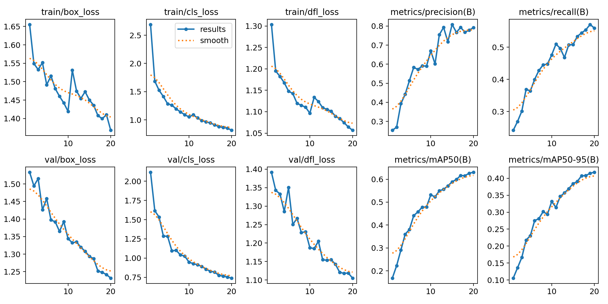

# Machine Learning Project: การตรวจจับชิ้นส่วนอิเล็กทรอนิกส์บนแผงวงจร (PCB Components Object Detection - YOLOv8)

## ภาพรวมโปรเจกต์ (Project Overview)
โปรเจกต์นี้เป็นการประยุกต์ใช้เทคนิค Deep Learning ทางด้านคอมพิวเตอร์วิทัศน์ (Computer Vision) โดยใช้สถาปัตยกรรมโครงข่าย YOLOv8 (You Only Look Once version 8) ในการตรวจจับและจำแนกประเภทชิ้นส่วนอิเล็กทรอนิกส์บนแผงวงจรพิมพ์ (PCB Components) โดยเน้นไปที่การศึกษาและเปรียบเทียบประสิทธิภาพระหว่างการตั้งค่าพารามิเตอร์การฝึกสอน (Training Configuration) 2 รูปแบบที่แตกต่างกัน (ปรับจำนวน Epochs, ขนาดภาพ และ Batch Size) นอกจากนี้ โปรเจกต์ยังมุ่งเน้นการแก้ปัญหาคอขวดในการประมวลผล ด้วยการตั้งค่าสภาพแวดล้อม (Environment) เฉพาะทางให้รองรับ PyTorch Nightly Build (CUDA 12.8) เพื่อดึงพลังการประมวลผลจากการ์ดจอสถาปัตยกรรมใหม่ (NVIDIA GeForce RTX 5060 - sm_120) มาใช้รันโมเดลด้วยความเร็วสูงสุด พร้อมทดสอบการทำงานทั้งในรูปแบบภาพนิ่งและวิดีโอแบบเรียลไทม์

## วัตถุประสงค์ (Objectives)
- ประยุกต์ใช้โมเดล YOLOv8 สำหรับงาน Object Detection เพื่อตรวจจับและตีกรอบ (Bounding Box) ชิ้นส่วนอิเล็กทรอนิกส์บนแผงวงจร
- สร้างและเปรียบเทียบประสิทธิภาพระหว่างการตั้งค่า Config 1 (10 Epochs, Image Size 480) และ Config 2 (20 Epochs, Image Size 640) 
- ทดลองและวิเคราะห์ผลลัพธ์ผ่านค่าตัวชี้วัดประสิทธิภาพเชิงลึก ได้แก่ Precision, Recall, mAP50 และ mAP50-95
- ตั้งค่า Environment การใช้งาน PyTorch ร่วมกับ Ultralytics เพื่อรองรับ GPU NVIDIA RTX 50 Series สถาปัตยกรรมใหม่ล่าสุดผ่านระบบปฏิบัติการ Windows
- พัฒนาระบบทดสอบการตรวจจับแบบอัตโนมัติ (Automated Search) และการตรวจจับสดผ่านกล้องเว็บแคม (Real-time Inference)

## ชุดข้อมูล (Dataset)
- **ชื่อชุดข้อมูล:** PCB Electronic Components
- **คำอธิบาย:** ชุดข้อมูลรูปภาพ (Image Data) ของแผงวงจรอิเล็กทรอนิกส์ที่ถูกจัดเตรียมในรูปแบบ YOLO Format โดยมีไฟล์ Labels กำหนดพิกัด Bounding Box ของชิ้นส่วนประเภทต่างๆ ข้อมูลถูกแบ่งสัดส่วนออกเป็นชุด `train/` (สำหรับการฝึกสอน), `valid/` (สำหรับการตรวจสอบ) และ `test/` (สำหรับการทดสอบ)
- **ที่มา (Source):** Kaggle

## โครงสร้างโปรเจกต์ (Project Structure)
```text
ML-10-Object Detection II/
├── dataset/
│   ├── test/
│   ├── train/
│   └── valid/
├── runs/
│   ├── detect/
│   │   └── runs/
│   │       ├── pcb_config1_10epochs/
│   │       └── pcb_config2_20epochs/
│   └── image_test/
├── evaluate.py
├── image_test.py
├── realtime_test.py
├── train.py
├── yolov8n.pt
└── README.md
```

## ขั้นตอนการทำงาน (Project Workflow)
1. **Model Training (`train.py`):** โหลดสถาปัตยกรรมต้นแบบ `yolov8n.pt` และดำเนินการฝึกสอน (Train) ผ่าน GPU สองรูปแบบ ได้แก่ Config 1 (10 Epochs, batch=8, imgsz=480) และ Config 2 (20 Epochs, batch=16, imgsz=640) โดยเปิดใช้งาน Automatic Mixed Precision (AMP)
2. **Model Evaluation (`evaluate.py`):** คำนวณค่าตัวชี้วัดประสิทธิภาพของโมเดลที่ฝึกสอนเสร็จแล้ว (best.pt) ด้วยชุดข้อมูลทดสอบ (Test split) เพื่อประเมินค่า Precision, Recall และ mAP
3. **Image Testing (`image_test.py`):** สุ่มรูปภาพจากโฟลเดอร์ Test จำนวน 5 รูป ป้อนเข้าสู่โมเดลที่ดีที่สุดเพื่อทดสอบวาดกรอบ Bounding Box พร้อมระบุความมั่นใจ (Confidence Score) และบันทึกผลลัพธ์อัตโนมัติ
4. **Real-time Inference (`realtime_test.py`):** ดึงภาพวิดีโอสดจากกล้องเว็บแคม ป้อนเข้าสู่โมเดลเพื่อตรวจจับชิ้นส่วนอิเล็กทรอนิกส์ในสภาพแวดล้อมจริงแบบ Real-time โดยค้นหาไฟล์น้ำหนักโมเดล (Weights) ล่าสุดอัตโนมัติ

## การแสดงผลข้อมูลและการประเมินผล (Data Visualization & Model Evaluation)
จากการทดลองเปรียบเทียบพารามิเตอร์ของโมเดล สามารถสรุปผลการทำงานในแต่ละส่วนได้ดังนี้:

### 1. ผลการประเมินประสิทธิภาพ (Evaluation Metrics)
| Configuration | Precision | Recall | mAP50 | mAP50-95 |
| :--- | :---: | :---: | :---: | :---: |
| Config 1 (10 Epochs, imgsz=480, batch=8) | *(นำค่าจาก Terminal มาใส่)* | *(นำค่าจาก Terminal มาใส่)* | *(นำค่าจาก Terminal มาใส่)* | *(นำค่าจาก Terminal มาใส่)* |
| Config 2 (20 Epochs, imgsz=640, batch=16)| *(นำค่าจาก Terminal มาใส่)* | *(นำค่าจาก Terminal มาใส่)* | *(นำค่าจาก Terminal มาใส่)* | *(นำค่าจาก Terminal มาใส่)* |

**วิเคราะห์ผล:** *(เพิ่มคำอธิบายเปรียบเทียบว่า Config ใดให้ค่าความแม่นยำและการตรวจจับครอบคลุมที่ดีกว่ากันหลังจากเพิ่มจำนวน Epochs และขยายขนาดภาพ)*

### 2. กราฟการเรียนรู้และค่าความสูญเสีย (Training Loss & Metrics Curve)


**Training History:** กราฟแสดงแนวโน้มค่า Loss (Box Loss, Object Loss, Class Loss) ที่ลดลงอย่างต่อเนื่อง แสดงให้เห็นว่าโมเดลเรียนรู้โครงสร้างของแผงวงจรและสามารถจำแนกพิกัดของชิ้นส่วนได้ดีขึ้นในแต่ละ Epoch โดยไม่มีอาการ Overfitting ชัดเจน

### 3. ผลการทดสอบจากรูปภาพ (Image Detection Results)
 
*(แทนที่ชื่อไฟล์ sample_image.jpg ด้วยชื่อรูปจริงจากโฟลเดอร์ image_test)*

จากการสุ่มภาพจำนวน 5 ภาพ โมเดลสามารถตีกรอบครอบวัตถุเป้าหมายบนแผงวงจรพร้อมระบุคลาสได้อย่างแม่นยำ แม้ชิ้นส่วนจะมีขนาดเล็กและทับซ้อนกัน

### 4. ผลการทดสอบตรวจจับสด (Real-time Webcam Detection)
โมเดลที่ถูกรันด้วย `realtime_test.py` สามารถประมวลผลเฟรมวิดีโอได้อย่างลื่นไหลผ่าน GPU สถาปัตยกรรม RTX 5060 และตีกรอบ Bounding Box ทันทีที่มีการนำชิ้นส่วนแผงวงจรมาส่องที่หน้ากล้อง

## ภาษาโปรแกรมและไลบรารี (Programming Language & Libraries)
- **ภาษาโปรแกรม:** Python 3.10
- **Environment:** Anaconda (Environment `yolo_gpu`)
- **ฮาร์ดแวร์ประมวลผล:** NVIDIA GeForce RTX 5060 (CUDA Capability sm_120)
- **ไลบรารีหลัก:**
  - `torch`, `torchvision`, `torchaudio` (เวอร์ชัน Pre-release/Nightly รองรับ **cu128** สำหรับสถาปัตยกรรม GPU ใหม่)
  - `ultralytics` (YOLOv8 Framework)
  - `opencv-python` (Image and Video Processing)

## ผลลัพธ์ที่ได้ (Output)
รูปภาพกราฟประวัติการฝึกสอน, โมเดลที่เทรนเสร็จแล้ว (`best.pt`, `last.pt`), เมทริกซ์ความสับสน (Confusion Matrix) ในรูปแบบภาพ, และรูปภาพการตรวจจับจากการสุ่มทดสอบ ทั้งหมดถูกบันทึกและจัดเก็บไว้อย่างเป็นระบบในโฟลเดอร์ `runs/`
